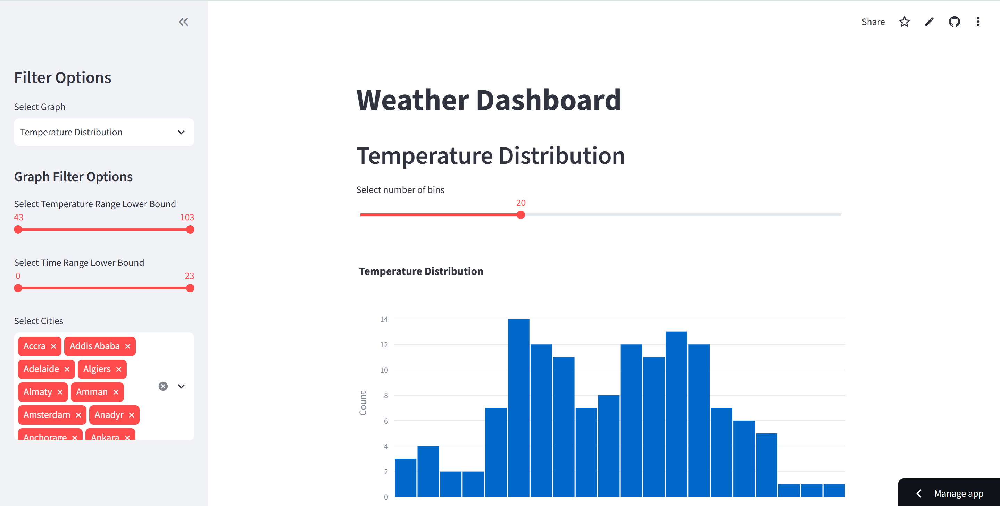

# Weather-Around-the-World
Snapshot of current temperature and local time across cities worldwide, shown in interactive visualizations on a Streamlit dashboard. Data scraped in accordance with the source’s robots.txt.

## What it does

Scrapes city, local time, and current temperature data from around the world from https://www.timeanddate.com/weather/.
Includes three interactive visualizations:
1. Temperature Distribution
2. Temperature Over Time
3. Hottest and Coldest Cities

## Live app

https://ac-weather-around-the-world.streamlit.app/

## Findings

Temperatures across the sampled cities tend to form distinct clusters rather than a single continuous spread. The city list spans multiple climate zones and both hemispheres, so tropical and high-latitude cities separate into groups instead of filling the middle of the range.

Local time turns out to be a weak predictor of temperature in a snapshot like this. Readings within the same local hour vary widely, because latitude and climate dominate time of day. A mild diurnal signal is usually visible — the warmest readings lean toward afternoon local hours — but it’s small relative to geographic variation.

Coverage across local hours is uneven. Since the scrape captures every city at the same instant, each city’s local hour is determined by its UTC offset, and the source’s city list isn’t evenly distributed across time zones. Some hours are therefore sparsely represented in any given run.

## Setup

Clone and install:

    git clone https://github.com/sleepypanda25/Weather-Around-the-World.git
    cd Weather-Around-the-World
    pip install -r requirements.txt

Run the dashboard:

    python -m streamlit run app.py

## Refreshing the data

`app.py` reads from `weather.db`. To re-scrape:

    python weather.py

Requires Chrome installed. The scraper replaces the table on each run.

## Project structure

Each scrape returns roughly 140 rows, one per city, with columns for city, local time, and current temperature in Fahrenheit.

    weather.py       scraping, cleaning, writes to weather.db
    app.py           Streamlit dashboard, reads weather.db
    weather.db       cleaned scraped data
    weather.csv      raw scraped data

## Limitations

1. Each run replaces existing data, so tables and visualizations show a snapshot of local time and do not accumulate historical data. Dashboard shows cross-sectional data of many cities in one instant, and therefore can't support true time-series analysis across runs.
2. The scraper is coupled to the structure of the source page. If timeanddate.com changes its markup, the scrape will need updating.
3. City selection is determined by timeanddate.com, not this project, so even coverage across time zones and geographical areas can't be balanced.

## Potential Future Improvements

1. Accumulating data from each run instead of replacing it to enable genuine time-series analysis.
2. Schedule scrapes to occur automatically at regular time intervals.